# ArmorIQ — Guarded AI Agent with MCP Support

> A full-stack AI agent security platform demonstrating a live policy/guardrails layer between an LLM and its MCP-connected tools.

---

## Table of Contents

1. [Overview](#overview)
2. [Architecture](#architecture)
3. [Project Structure](#project-structure)
4. [How Each Part Works](#how-each-part-works)
   - [AI Agent (Backend)](#ai-agent-backend)
   - [Policy Engine](#policy-engine)
   - [Custom MCP Server](#custom-mcp-server)
   - [Remote MCP — Context7](#remote-mcp--context7)
   - [Guardrails Dashboard (Frontend)](#guardrails-dashboard-frontend)
5. [Data Flow: A Single Tool Call](#data-flow-a-single-tool-call)
6. [Policy Rule Types](#policy-rule-types)
7. [Live Rule Propagation (No Restart)](#live-rule-propagation-no-restart)
8. [Tool Discovery — Zero Hardcoding](#tool-discovery--zero-hardcoding)
9. [API Reference](#api-reference)
10. [Local Setup](#local-setup)
11. [Environment Variables](#environment-variables)
12. [Deployment](#deployment)
13. [Design Decisions & Tradeoffs](#design-decisions--tradeoffs)
14. [Known Limitations](#known-limitations)

---

## Overview

ArmorIQ is a miniature version of an AI agent security platform. It places a **policy engine** between an LLM (Gemini) and its external tools (MCP servers) — the policy engine is the heart of the system, not an afterthought.

Every tool call the LLM wants to make is intercepted, evaluated against live admin-configured rules, and either:
- **Allowed** (possibly with argument rewriting, e.g., path normalization)
- **Blocked** outright with a reason fed back to the model
- **Held for human approval** with a configurable timeout before the loop continues

Rules created in the dashboard take effect **immediately** on a running agent — no restart required.

---

## Architecture

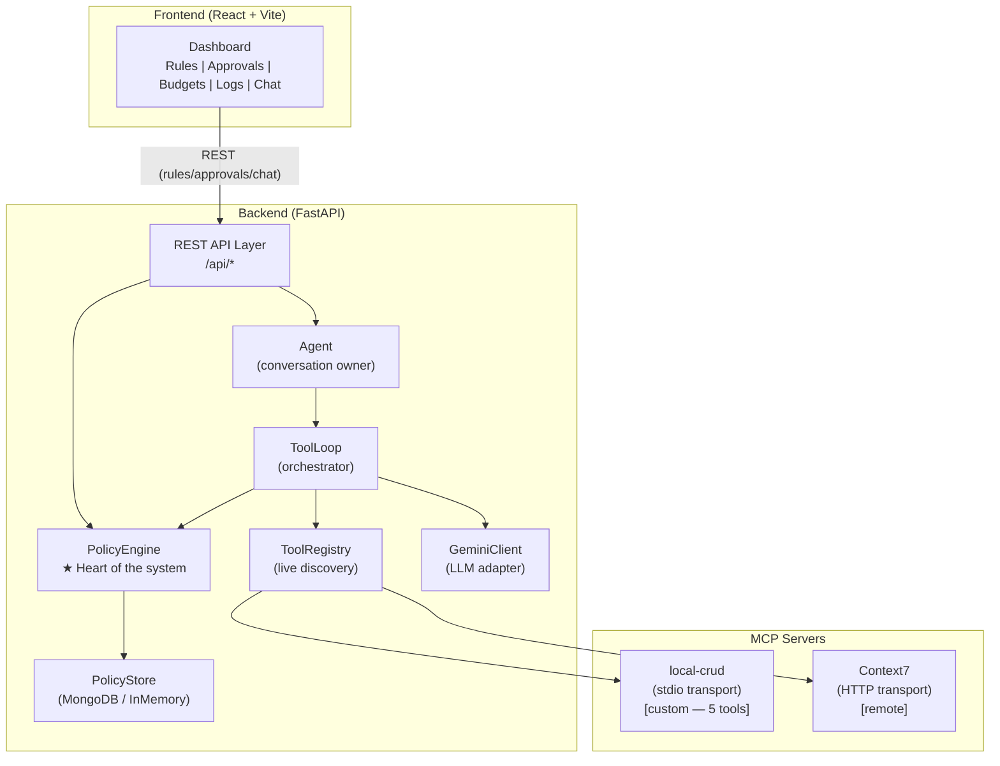

---

## Project Structure

```
armoriq/
├── backend/
│   ├── app.py                   # Uvicorn entrypoint (re-exports backend.api.app)
│   ├── requirements.txt
│   ├── agent/
│   │   ├── agent.py             # Conversation state owner
│   │   ├── agent_manager.py     # Lifecycle: create/get/reset/delete Agents
│   │   ├── chat_store.py        # Protocol + InMemory/Mongo chat persistence
│   │   ├── tool_loop.py         # THE loop: LLM ↔ Policy ↔ MCP
│   │   └── test/
│   │       └── test_agent_scenarios.py  # End-to-end scenario walkthrough
│   ├── api/
│   │   ├── app.py               # FastAPI app factory + lifespan
│   │   ├── dependencies.py      # Singleton providers (lru_cache)
│   │   ├── exceptions.py        # Global exception → HTTP handlers
│   │   ├── schemas.py           # Pydantic request/response models
│   │   └── routers/
│   │       ├── rules.py         # CRUD for policy rules
│   │       ├── approvals.py     # Approve / reject pending tool calls
│   │       ├── budgets.py       # Set/get token budgets per conversation
│   │       ├── logs.py          # Policy decision audit log
│   │       ├── chat.py          # Chat endpoint (POST /api/chat)
│   │       └── tools.py         # List discovered MCP tools
│   ├── llm/
│   │   ├── base.py              # BaseLLMClient + Message/ToolCall/ToolSpec
│   │   └── gemini.py            # Gemini API adapter
│   ├── mcp/
│   │   ├── manager.py           # MCPManager: register/connect/disconnect transports
│   │   ├── registry.py          # ToolRegistry: discover + execute (NO hardcoding)
│   │   ├── models.py            # RegisteredTool dataclass
│   │   ├── server.py            # ★ Custom MCP server (5 CRUD tools over stdio)
│   │   └── transport/
│   │       ├── base.py          # Transport Protocol
│   │       ├── stdio_transport.py
│   │       └── streamble_http_transport.py
│   └── policy/
│       ├── engine.py            # PolicyEngine: evaluate() + check_budget()
│       ├── models.py            # PolicyRule, ApprovalRequest, BudgetState, ...
│       ├── store.py             # PolicyStore Protocol + InMemoryPolicyStore
│       ├── mongo_store.py       # MongoPolicyStore (production)
│       ├── mongo_connection.py  # MongoDB client factory
│       └── approvals.py        # ApprovalManager: submit/wait/approve/reject
├── frontend/
│   ├── src/
│   │   ├── App.tsx
│   │   ├── pages/
│   │   │   ├── Rules.tsx        # Create/edit/delete/toggle rules
│   │   │   ├── Approvals.tsx    # See pending; approve or reject
│   │   │   ├── Budgets.tsx      # Set token cap per conversation
│   │   │   ├── Logs.tsx         # Full audit trail
│   │   │   └── Chat.tsx         # Talk to the guarded agent live
│   │   └── api/
│   │       └── client.ts        # Typed API client
│   ├── package.json
│   └── vite.config.ts
├── run_agent.py                 # CLI REPL for local testing
├── DEPLOYMENT.md
└── vercel.json
```

---

## How Each Part Works

### AI Agent (Backend)

**`backend/agent/agent.py` — `Agent`**

The `Agent` class is deliberately the *most ignorant* class in the system. It owns:
- `conversation_id` — a stable UUID for this conversation
- `messages: list[Message]` — the conversation history
- `system_prompt` — seeds the history

It delegates *everything* about how a reply is produced to an injected `ToolLoop`. It has zero imports from the LLM, MCP, or policy packages. This means the same `Agent` runs from a FastAPI route, a CLI REPL, or a test harness — unchanged.

Key design: `chat()` builds `pending_history = self._messages + [user_message]`, awaits `tool_loop.run()`, then **only** commits `self._messages = result.messages` on success. A failed turn never leaves history half-updated.

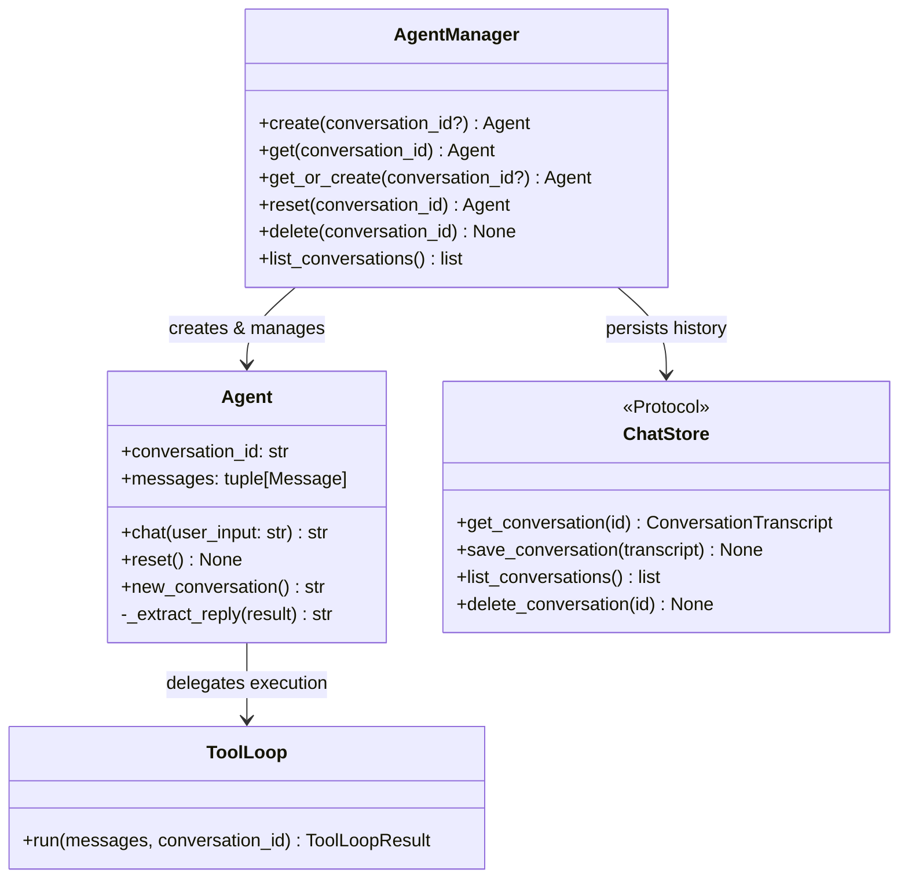

**`backend/agent/tool_loop.py` — `ToolLoop`**

This is the LLM ↔ MCP orchestration engine. Its loop per turn:

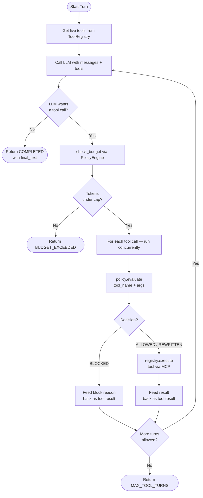

`ToolLoop` depends on `PolicyEngine` **only via a structural Protocol** defined in this same file — it never imports `backend/policy/*`. One-way dependency.

**`backend/agent/agent_manager.py` — `AgentManager`**

One `AgentManager` lives for the FastAPI process lifetime. It maps `conversation_id → Agent`. On `get()`, if an agent isn't in the in-memory dict, it rehydrates from `ChatStore` (MongoDB in production). Every `chat()` call persists the updated transcript back to the store.

---

### Policy Engine

**`backend/policy/engine.py` — `PolicyEngine`**

The heart of the system. Called for every tool call before execution.

```python
async def evaluate(*, conversation_id, tool_name, arguments) -> PolicyDecision:
```

Rule matching priority (highest `priority` int wins):
1. Load all enabled rules from `PolicyStore` (live read — rules changed in the dashboard are immediately visible)
2. Match rules against `tool_name` using `EXACT`, `GLOB`, or `REGEX` matching
3. Apply the winning rule's action:
   - `BLOCK` → `PolicyDecision(allowed=False, reason=...)`
   - `ALLOW` with constraints → validate/rewrite arguments, then `PolicyDecision(allowed=True, arguments=rewritten)`
   - `REQUIRE_APPROVAL` → submit to `ApprovalManager`, poll until approved/rejected/timeout

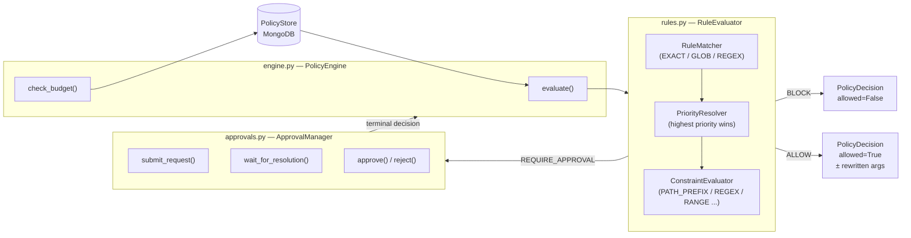

**`backend/policy/models.py` — Core data models**

| Model | Purpose |
|---|---|
| `PolicyRule` | Rule definition: pattern, action, constraints, priority, timeout |
| `ArgumentConstraint` | Input validation: `PATH_PREFIX`, `REGEX`, `ALLOWLIST`, `DENYLIST`, `RANGE` |
| `ApprovalRequest` | Pending tool call awaiting human decision |
| `ConversationBudget` | Max token ceiling per `conversation_id` |
| `PolicyDecisionLog` | Immutable audit entry written on every evaluate() call |

**`backend/policy/approvals.py` — `ApprovalManager`**

Manages the human-in-the-loop flow:
- `submit_request()` — creates a pending approval, stores it
- `wait_for_resolution(id, timeout)` — polls the store until resolved or timeout fires
- `approve(id, resolved_by, reason)` — admin approves from dashboard
- `reject(id, resolved_by, reason)` — admin rejects from dashboard

The `ToolLoop` never sees "pending" — it awaits `wait_for_resolution()` which blocks until a decision is made. If nobody responds within `approval_timeout_seconds`, it auto-denies.

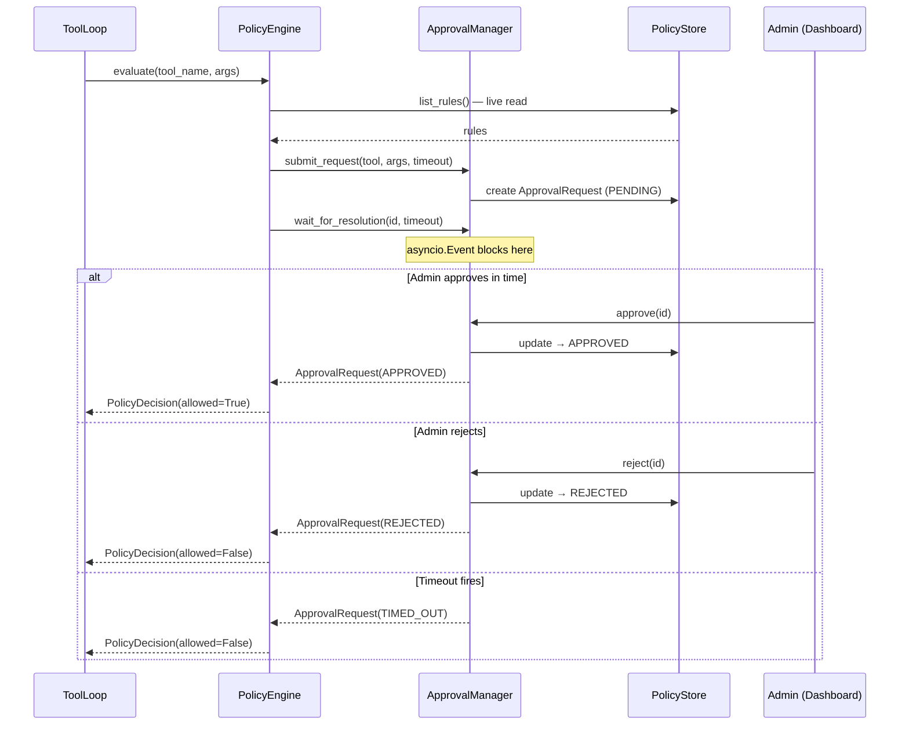

**`backend/policy/mongo_store.py` — `MongoPolicyStore`**

Production persistence for rules, approvals, budgets, and logs. All stored in MongoDB. Because `PolicyEngine` reads rules from the store on every `evaluate()` call (no in-process cache of the rule set), dashboard changes propagate to running agents **instantly** — no polling, no websockets needed, no restart.

---

### Custom MCP Server

**`backend/mcp/server.py`** — built with FastMCP over stdio transport.

Exposes 5 tools:

| Tool | Description | Notable Policy Demo |
|---|---|---|
| `list_records` | List all records in the in-memory DB | Freely allowed |
| `read_record(key)` | Fetch one record | Demo: requires approval (short 4s timeout → auto-deny) |
| `create_record(key, name, role, storage_path)` | Insert record | Demo: `storage_path` must be under `/sandbox/` — rewritten if not |
| `update_record(key, ...)` | Partial update | Demo: requires human approval (30s timeout, auto-approved in test) |
| `delete_record(key)` | Permanent deletion | Demo: **always blocked** by policy rule |

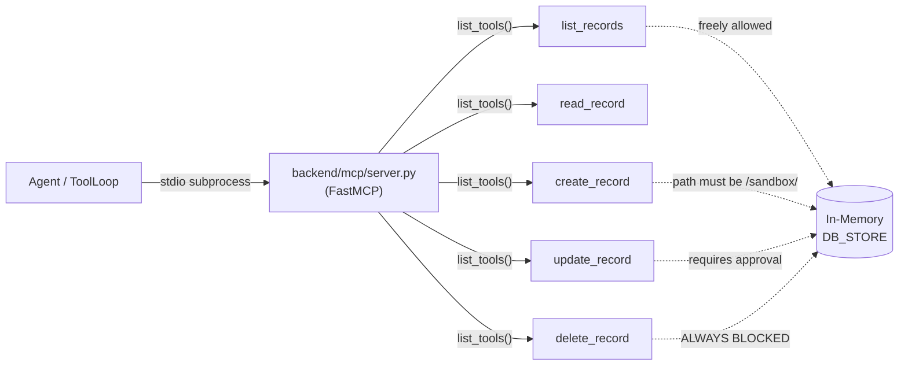

The server is started as a subprocess by the backend process (via `StdioTransport`) — no separate deploy step. It is entirely plug-and-play: adding it to `MCPManager` makes its tools auto-discovered by `ToolRegistry.discover()` with zero agent-side code changes.

---

### Remote MCP — Context7

Registered via `StreamableHTTPTransport` pointing to `https://mcp.context7.com/mcp`. Requires `CONTEXT7_API_KEY`. If the key is absent, the backend logs a warning and continues with local-crud only. Context7 tools are discovered alongside local tools at startup — the agent uses whichever tools make sense for a given prompt.

---

### Guardrails Dashboard (Frontend)

Built with React + Vite + TypeScript. Five pages, all talking to the FastAPI backend:

| Page | What it does |
|---|---|
| **Rules** | Create, edit, enable/disable, delete policy rules with full form (action, pattern, rule type, priority, constraints, approval timeout) |
| **Approvals** | Live list of pending tool calls; approve or reject with a reason |
| **Budgets** | Set per-conversation token cap; view current usage |
| **Logs** | Audit trail of every policy decision: tool name, outcome, conversation, timing, reason |
| **Chat** | Live chat with the guarded agent; see tool calls and policy outcomes in-thread |

---

## Data Flow: A Single Tool Call

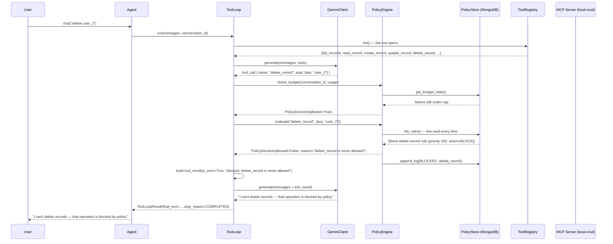

---

## Policy Rule Types

### Rule Actions

| Action | Behavior |
|---|---|
| `BLOCK` | Tool call is denied immediately; reason fed to LLM |
| `ALLOW` | Tool call proceeds; optionally with argument constraint checking/rewriting |
| `REQUIRE_APPROVAL` | Tool call is held; agent waits up to `approval_timeout_seconds` for a human decision |

### Rule Matching Types

| Type | Example pattern | Matches |
|---|---|---|
| `EXACT` | `delete_record` | Only `delete_record` |
| `GLOB` | `*_record` | All tools ending in `_record` |
| `REGEX` | `^(create\|update)_.*` | Tools starting with create_ or update_ |

### Argument Constraints (`ArgumentConstraint`)

| Constraint Type | What it validates |
|---|---|
| `PATH_PREFIX` | Argument must start with a given path prefix (e.g., `/sandbox/`) |
| `REGEX` | Argument must match a regex |
| `ALLOWLIST` | Argument must be one of a set of allowed values |
| `DENYLIST` | Argument must NOT be one of a set of denied values |
| `RANGE` | Numeric argument must be within `[min, max]` |

If `allow_rewrite=True` on a constraint, the policy engine can **rewrite** the argument to a valid value (e.g., strip a path traversal attack) instead of outright denying.

### Rule Priority Resolution

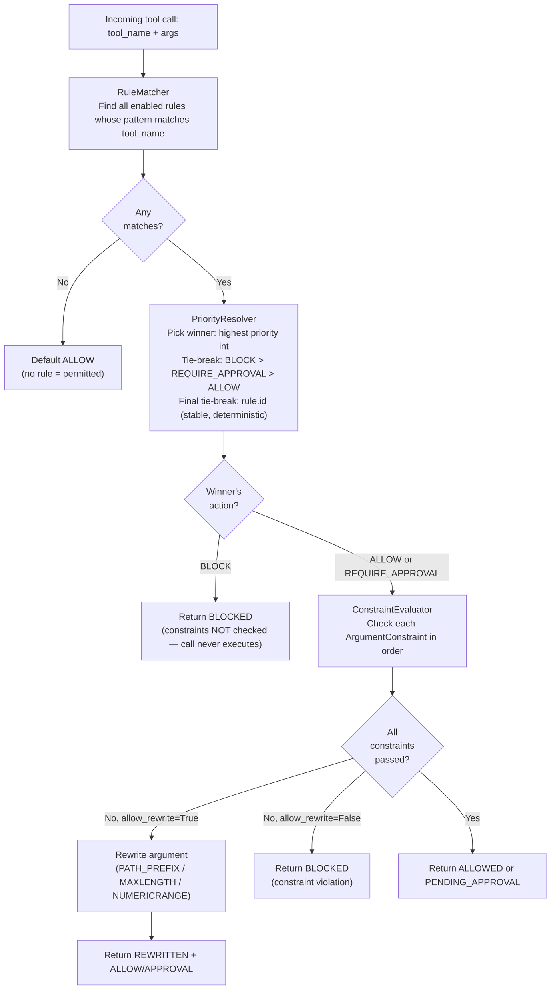

---

## Live Rule Propagation (No Restart)

This is achieved through a deliberate architectural choice: **`PolicyEngine.evaluate()` reads rules from `PolicyStore` on every single call** — there is no in-process rule cache.

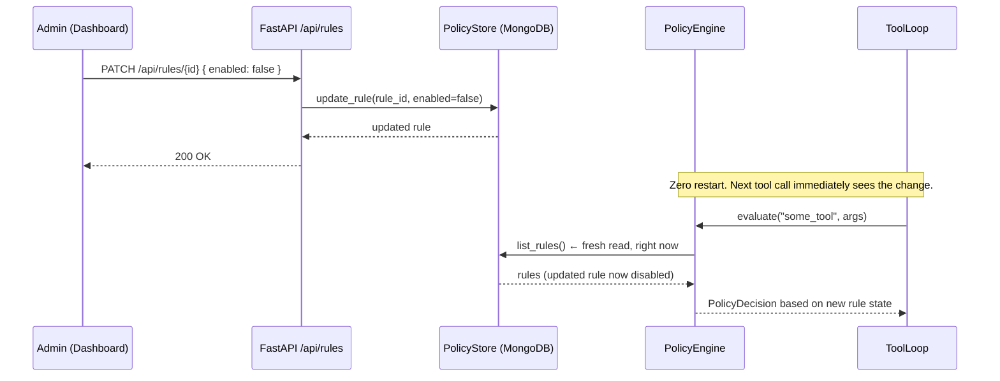

When an admin creates or toggles a rule in the dashboard (via `PATCH /api/rules/{id}`), the MongoDB document is updated. The very next tool call the agent makes reads that updated state. No polling interval, no websocket push needed — the store is the single source of truth and it's always read fresh.

---

## Tool Discovery — Zero Hardcoding

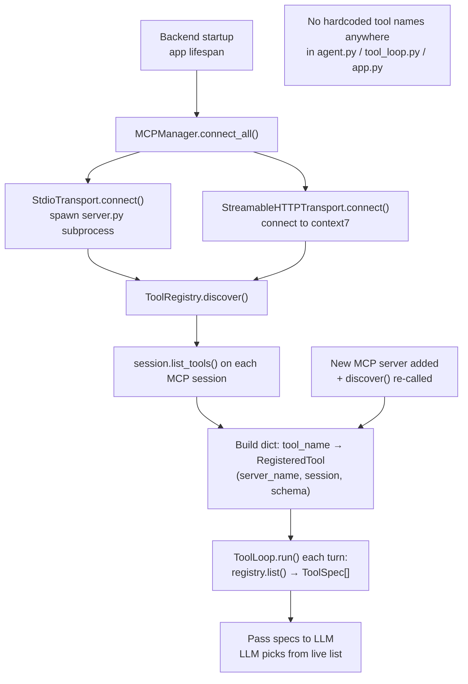

`ToolRegistry.discover()` iterates every connected MCP session and calls `session.list_tools()`. The result is stored in a `dict[str, RegisteredTool]` keyed by tool name. The `ToolLoop` calls `registry.list()` on every turn and builds `ToolSpec` objects from whatever is currently registered — if a new MCP server is added and `discover()` is re-called, the agent picks up its tools automatically on the next turn.

There is no hardcoded tool list anywhere in `agent.py`, `tool_loop.py`, `app.py`, or `dependencies.py`.

---

## API Reference

All endpoints are under `/api/`:

| Method | Path | Description |
|---|---|---|
| `GET` | `/api/health` | Backend health + rule/approval counts |
| `GET` | `/api/rules` | List all policy rules |
| `POST` | `/api/rules` | Create a new rule |
| `GET` | `/api/rules/{id}` | Get one rule |
| `PUT` | `/api/rules/{id}` | Replace a rule |
| `PATCH` | `/api/rules/{id}` | Partial update (e.g., toggle enabled) |
| `DELETE` | `/api/rules/{id}` | Delete a rule |
| `GET` | `/api/approvals` | List pending approvals |
| `POST` | `/api/approvals/{id}/approve` | Approve a pending tool call |
| `POST` | `/api/approvals/{id}/reject` | Reject a pending tool call |
| `GET` | `/api/budgets/{conversation_id}` | Get budget state |
| `PUT` | `/api/budgets/{conversation_id}` | Set token cap |
| `GET` | `/api/logs` | Get policy decision audit log |
| `POST` | `/api/chat` | Send a message to the agent |
| `GET` | `/api/chat/conversations` | List all conversations |
| `GET` | `/api/tools` | List all currently discovered MCP tools |

Full interactive docs at `/docs` (Swagger UI).

---

## Local Setup

### Prerequisites

- Python 3.10+
- Node.js 18+
- MongoDB (local or Atlas)

### Backend

```bash
# Clone and enter project
git clone <repo-url>
cd armoriq

# Create virtual environment
python -m venv .venv
source .venv/bin/activate  # Windows: .venv\Scripts\activate

# Install dependencies
pip install -r backend/requirements.txt

# Copy and fill in environment variables
cp .env.example .env
# Edit .env — see Environment Variables section below

# Start the backend
python -m uvicorn backend.app:app --host 0.0.0.0 --port 8000 --reload
```

### Frontend

```bash
cd frontend
npm install
npm run dev
# Opens at http://localhost:5173
```

### CLI Agent (optional)

```bash
# From project root
python run_agent.py
# Drops into an interactive REPL wired to local-crud + Context7 (if key set)
```

### End-to-End Scenario Test

```bash
# Runs all 13 scenarios (blocking, rewriting, approval, timeout, budget, etc.)
python backend/agent/test/test_agent_scenarios.py
```

---

## Environment Variables

| Variable | Required | Description |
|---|---|---|
| `GEMINI_API_KEY` | ✅ | Google Gemini API key |
| `GEMINI_API_KEYS` | Optional | Comma-separated keys for round-robin rotation |
| `GEMINI_API_KEY_1`, `_2`, ... | Optional | Numbered keys for round-robin |
| `MONGO_USER` | ✅ | MongoDB username |
| `MONGO_PASS` | ✅ | MongoDB password |
| `MONGO_HOST_URI` | ✅ | MongoDB host URI (e.g., cluster.mongodb.net) |
| `MONGO_DB_NAME` | ✅ | Database name |
| `MONGO_APP_NAME` | ✅ | App name for MongoDB connection string |
| `CONTEXT7_API_KEY` | Optional | Enables the Context7 remote MCP server |
| `VITE_API_BASE_URL` | Frontend | Backend URL for deployed frontend (build-time) |

---

## Deployment

### Backend (Azure App Service)

The `.github/workflows/main_amoriqbackend.yml` CI/CD pipeline:
1. Checks out code
2. Installs dependencies into a virtual env (early failure detection)
3. Uploads artifact (excluding venv)
4. Deploys to Azure App Service (`amoriqbackend`, Central India)

```
Backend URL: https://amoriqbackend-dqd9hyafgre3hxdn.centralindia-01.azurewebsites.net
```

### Frontend (Azure Static Web Apps)

The `.github/workflows/azure-static-web-apps-*.yml` pipeline builds from `./frontend`, outputs to `dist/`, and injects `VITE_API_BASE_URL` at build time.

```
Frontend URL: https://lively-pebble-0a440c100.7.azurestaticapps.net
```

### CI/CD Pipeline Overview

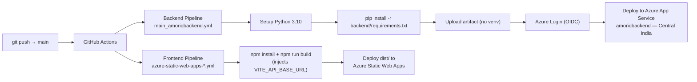

### Notes

- The local-crud `StdioTransport` is **skipped on Vercel** (detected via `VERCEL` env var) to prevent serverless function subprocess hangs. Azure App Service supports long-running processes so it works there.
- MongoDB Atlas is used in production — the backend will refuse to start if credentials are invalid (fail-fast startup).

---

## Design Decisions & Tradeoffs

### PolicyEngine as a structural Protocol dependency

`ToolLoop` never imports from `backend/policy/`. It depends only on the `PolicyEngine` Protocol defined in `tool_loop.py` itself. This means you can drop in a test stub (`AllowAllPolicy` ships in the same file), swap implementations, or mock without touching the loop. The same pattern applies throughout: `BaseLLMClient` in `llm/base.py`, `ChatStore` and `PolicyStore` are both Protocols.

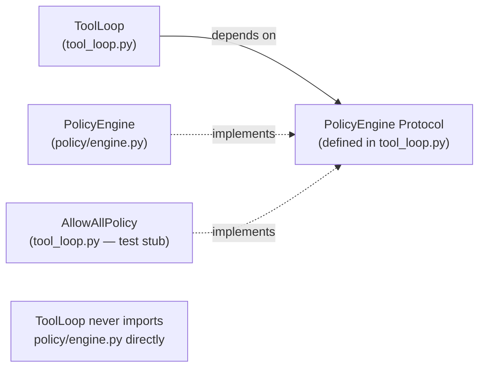

### Live rule reads vs. caching

Reading from MongoDB on every `evaluate()` call adds a small latency per tool call. The tradeoff is correctness: you can never have a stale cache in an active conversation. For the scale this assignment targets, the latency is acceptable. A production system at scale would add a short TTL cache (e.g., 1–5 seconds) with explicit invalidation on writes.

### Agent-per-conversation, not per-request

Each `conversation_id` gets exactly one `Agent`. The `AgentManager` holds them in memory and falls back to MongoDB for rehydration after a restart. This gives O(1) history access during an active session and durability across restarts.

### No singleton globals in agent logic

`dependencies.py` uses `@lru_cache(maxsize=1)` for singleton semantics — but only at the FastAPI dependency layer. The agent, policy, and MCP modules never reach for global state. This keeps them unit-testable and reusable from a CLI (`run_agent.py`) without the FastAPI layer.

### Human approval as a blocking await

`ApprovalManager.wait_for_resolution()` polls the store on a short interval until the approval is resolved or the timeout fires. The tool loop is suspended during this wait — from the user's perspective the agent is "thinking." An alternative (streaming responses, SSE) would allow partial progress updates, but adds significant frontend complexity and is out of scope for a 3-day build.

### FailureMode: FAIL_CLOSED vs FAIL_OPEN

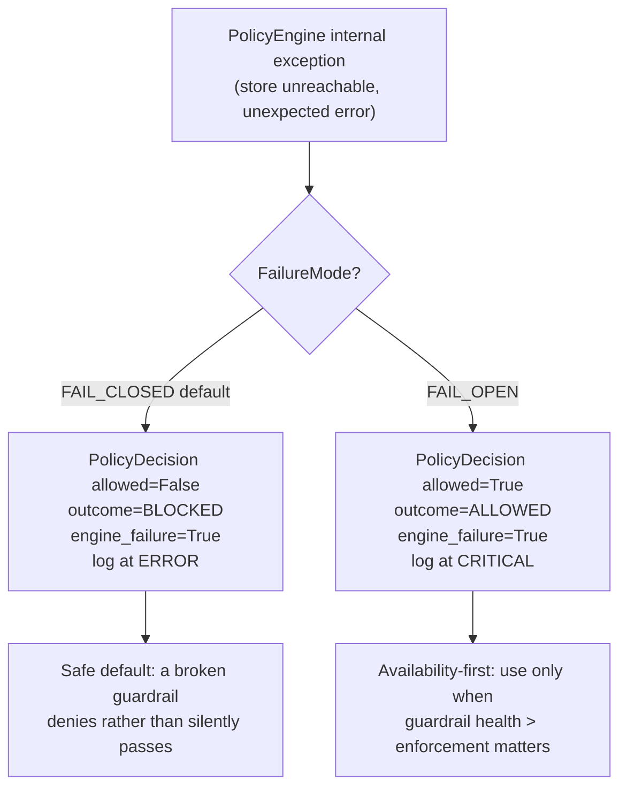

---
