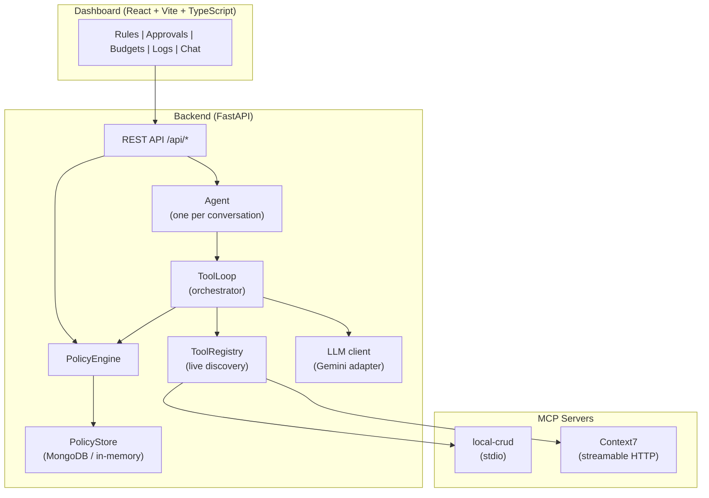

# Guarded AI Agent

**A policy-enforced AI agent that puts a live guardrail layer between an LLM and its MCP tools.**

LLM agents that can call tools can also call the *wrong* tools: deleting records, writing outside a sandbox, or burning through a token budget. Guarded AI Agent intercepts every tool call the model makes and evaluates it against admin-defined policy rules before anything executes. Each call is:

- **allowed**, optionally with its arguments rewritten into a safe form (for example, forcing a file path under `/sandbox/`)
- **blocked**, with the reason fed back to the model so it can respond gracefully
- **held for human approval**, with a configurable timeout

Rules are edited from a web dashboard and take effect on the very next tool call, with no restart.


---

## Features

- **Policy engine on every tool call**: allow, block, rewrite or require approval, decided per call.
- **Flexible rule matching**: exact, glob (`*_record`) and regex (`^(create|update)_.*`) tool patterns with deterministic priority resolution.
- **Argument constraints**: path prefix, regex, allowlist, denylist and numeric range checks, with optional safe rewriting instead of outright denial.
- **Human-in-the-loop approvals**: risky calls pause the agent until a reviewer approves or rejects them, or the timeout expires.
- **Token budgets**: per-conversation token caps stop runaway agents.
- **Fail-closed by default**: if the policy engine itself errors, tool calls are denied rather than silently allowed.
- **Live rule updates**: rules are read fresh on every evaluation, so dashboard changes apply immediately.
- **Dynamic MCP tool discovery**: tools are discovered at startup from every connected MCP server (stdio and streamable HTTP); no tool names are hardcoded in the agent.
- **Full audit trail**: every decision is logged with tool, outcome, reason, conversation and timing.
- **Admin dashboard**: manage rules, approvals, budgets and logs, and chat with the guarded agent.

---

## Architecture



| Component | Responsibility |
|---|---|
| `backend/agent/` | Conversation ownership, the tool-calling loop, concurrent tool execution, turn limits and persisted chat history |
| `backend/policy/` | Rule matching, priority resolution, argument constraints, approvals, budgets and audit logging |
| `backend/mcp/` | MCP transports (stdio, streamable HTTP), connection management and the tool registry |
| `backend/llm/` | Provider-agnostic LLM interface plus the Gemini implementation (function calling, API-key rotation) |
| `backend/api/` | FastAPI routers for rules, approvals, budgets, logs, tools and chat |
| `frontend/` | The admin dashboard |

The agent loop depends only on interfaces (`PolicyEngine`, `BaseLLMClient`, `PolicyStore`, `ChatStore`), so the policy engine, model provider or storage backend can be swapped or stubbed without touching the loop.

---

## How a tool call is guarded

```mermaid
sequenceDiagram
    participant U as User
    participant TL as ToolLoop
    participant LLM as LLM
    participant PE as PolicyEngine
    participant MCP as MCP Server

    U->>TL: "delete user_2"
    TL->>LLM: messages + live tool specs
    LLM-->>TL: tool_call delete_record {key: "user_2"}
    TL->>PE: check_budget(conversation)
    PE-->>TL: within budget
    TL->>PE: evaluate("delete_record", args)
    PE-->>TL: BLOCKED: "delete_record is never allowed"
    Note over TL,MCP: The MCP server is never called
    TL->>LLM: tool_result (error + reason)
    LLM-->>U: "I can't delete records; that operation is blocked by policy."
```

### Rule actions

| Action | Behavior |
|---|---|
| `ALLOW` | The call proceeds, after any argument constraints are checked or rewritten |
| `BLOCK` | The call is denied immediately and the reason is returned to the model |
| `REQUIRE_APPROVAL` | The call is held until a human approves or rejects it, or `approval_timeout_seconds` passes |

### Priority resolution

When several enabled rules match a tool, the highest `priority` wins. Ties are broken by action severity (`BLOCK` > `REQUIRE_APPROVAL` > `ALLOW`) and then by rule ID, so the outcome is always deterministic. If no rule matches, the call is allowed.

### Argument constraints

| Constraint | Validates |
|---|---|
| `PATH_PREFIX` | The argument starts with a given prefix, such as `/sandbox/` |
| `REGEX` | The argument matches a pattern |
| `ALLOWLIST` / `DENYLIST` | The argument is, or is not, in a set of values |
| `RANGE` | A numeric argument falls within `[min, max]` |

With `allow_rewrite=True`, a violating argument is rewritten to a safe value instead of the call being blocked.

---

## Demo MCP server

`backend/mcp/server.py` is a small FastMCP server over stdio, used to demonstrate each policy behavior:

| Tool | Demonstrates |
|---|---|
| `list_records` | Freely allowed |
| `read_record` | Requires approval; a short timeout auto-denies |
| `create_record` | `storage_path` is rewritten to stay under `/sandbox/` |
| `update_record` | Requires human approval |
| `delete_record` | Always blocked |

The remote [Context7](https://context7.com) MCP server is also connected over streamable HTTP when `CONTEXT7_API_KEY` is set, and its tools are governed by the same rules.

---

## Getting started

### Prerequisites

- Python 3.10+
- Node.js 18+
- MongoDB (local or Atlas)
- A Google Gemini API key

### Backend

```bash
git clone https://github.com/Vamshi9415/guarded-ai-agent-mcp.git
cd guarded-ai-agent-mcp

python -m venv .venv
source .venv/bin/activate        # Windows: .venv\Scripts\activate
pip install -r backend/requirements.txt

# Create a .env file in the project root (see Configuration below)

python -m uvicorn backend.app:app --host 0.0.0.0 --port 8000 --reload
```

Interactive API docs are served at `http://localhost:8000/docs`.

### Dashboard

```bash
cd frontend
npm install
npm run dev                      # http://localhost:5173
```

### Command-line agent (optional)

```bash
python run_agent.py              # interactive REPL with the same guardrails
```

---

## Configuration

| Variable | Required | Description |
|---|---|---|
| `GEMINI_API_KEY` | Yes | Google Gemini API key |
| `GEMINI_API_KEYS` | No | Comma-separated keys for round-robin rotation |
| `MONGO_USER`, `MONGO_PASS` | Yes | MongoDB credentials |
| `MONGO_HOST_URI` | Yes | MongoDB host, for example `cluster.mongodb.net` |
| `MONGO_DB_NAME` | Yes | Database name |
| `MONGO_APP_NAME` | Yes | App name used in the connection string |
| `CONTEXT7_API_KEY` | No | Enables the Context7 remote MCP server |
| `VITE_API_BASE_URL` | Dashboard | Backend URL used by the built dashboard |

---

## API

| Method | Path | Description |
|---|---|---|
| `GET` | `/api/health` | Health check with rule and approval counts |
| `GET` `POST` | `/api/rules` | List or create policy rules |
| `GET` `PUT` `PATCH` `DELETE` | `/api/rules/{id}` | Read, replace, update or delete a rule |
| `GET` | `/api/approvals` | List pending approvals |
| `POST` | `/api/approvals/{id}/approve` | Approve a held tool call |
| `POST` | `/api/approvals/{id}/reject` | Reject a held tool call |
| `GET` `PUT` | `/api/budgets/{conversation_id}` | Read or set a token budget |
| `GET` | `/api/logs` | Policy decision audit log |
| `GET` | `/api/tools` | Currently discovered MCP tools |
| `POST` | `/api/chat` | Send a message to the agent |
| `GET` | `/api/chat/conversations` | List conversations |

---

## Testing

```bash
pytest backend/policy/test backend/api/tests        # policy engine and API tests
python backend/agent/test/test_agent_scenarios.py   # end-to-end policy scenarios
```

The scenario suite exercises blocking, argument rewriting, approvals, approval timeouts and budget enforcement against a live agent.

---

## Design decisions

- **Fresh rule reads instead of a cache.** Every evaluation reads rules from the store, so a rule change can never be missed by an active conversation. The cost is one store read per tool call; a short TTL cache that is invalidated on writes is the natural next step at higher volume.
- **Fail-closed by default.** If the store is unreachable or the engine throws, the decision is `BLOCKED` and logged at error level. `FAIL_OPEN` is available for deployments that prioritize availability over enforcement, and it logs at critical level.
- **Event-driven approvals.** A held call waits on an `asyncio.Event` with a timeout rather than polling the store, and resumes as soon as a reviewer decides.
- **One agent per conversation.** Active conversations stay in memory for fast history access and are rehydrated from MongoDB after a restart.
- **Interfaces at every seam.** The loop never imports the policy, storage or provider implementations directly, which keeps each part unit-testable and usable from the CLI without FastAPI.

---

## Security note

The admin API does not yet authenticate requests. Run it only on a trusted network, or put it behind an authenticating proxy, until authentication lands.

## Roadmap

- Authentication and role-based access for admins and reviewers
- Cross-process approval signaling (MongoDB change streams or Redis) for multi-worker deployments
- Streaming of tool calls and approval status to the chat UI
- Additional LLM providers through the existing client interface
- Enforcement of conversation- and user-scoped rules
- Detection of prompt injection in tool outputs
